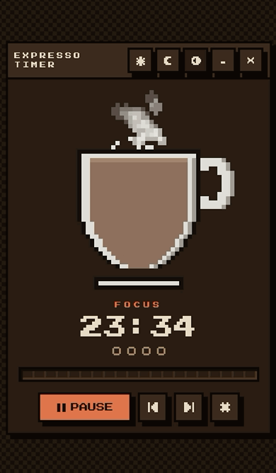

# ☕ Expresso Timer

Pomodoro em pixel art. Conforme a sessão de foco avança, o café baixa na xícara e a
fumaça vai rareando. No intervalo o processo se inverte — a xícara reenche.

Next.js 16 · React 19 · Tailwind v4 · shadcn/ui · arquitetura hexagonal

## Preview



## Rodando

```bash
pnpm install
pnpm dev          # http://localhost:3000
```

Requer Node 22+ e pnpm 10+.

## Comandos

| Comando            | O quê                                                  |
| ------------------ | ------------------------------------------------------ |
| `pnpm dev`         | Servidor de desenvolvimento                            |
| `pnpm build`       | Build de produção                                      |
| `pnpm test`        | Testes do núcleo (Vitest)                              |
| `pnpm verify`      | Tudo: formato, lint, regras de design, tipos, testes   |
| `pnpm format`      | Formata com Prettier                                   |
| `pnpm gen:favicon` | Regera `src/app/icon.svg` a partir da matriz de pixels |

## Funcionalidades

- Ciclos de foco e pausa configuráveis, com pausa longa a cada N focos
- Xícara em pixel art desenhada em canvas, com fumaça animada por partículas
- Tema claro / escuro / sistema
- Som e notificação do sistema ao terminar uma fase
- Preferências e histórico de sessões salvos localmente
- Respeita `prefers-reduced-motion`

## Arquitetura

Regra de dependência: `ui → application → domain`. A infraestrutura implementa as portas
declaradas em `application/ports.ts` e é injetada na borda.

```
src/
├── domain/          # núcleo puro — zero I/O, zero framework
│   ├── timer/       # máquina de estados da sessão
│   ├── cup/         # nível do café e simulação da fumaça
│   └── pixelart/    # paleta e sprites como dado
├── application/     # portas + orquestração (PomodoroService)
├── infrastructure/  # canvas, localStorage, WebAudio, Notification
└── ui/              # React, componentes shadcn restilizados
```

Duas decisões que explicam o resto do código:

**O tempo é derivado, nunca acumulado.** A sessão guarda marcos (`startedAt`,
`elapsedBeforeMs`) e recalcula o restante a partir do relógio a cada leitura. Aba em
background, throttling e sleep do sistema não causam drift — e o núcleo é testável com um
relógio falso, sem timers reais.

**Cor vive em duas camadas.** Cores de sprite (`--px-ink`, `--px-coffee`, …) são do que a
xícara é feita e pertencem ao canvas. Cores semânticas (`--px-surface`, `--px-text`, …)
são do que a interface é feita e invertem entre os temas. Uma xícara de cerâmica não fica
preta só porque a página ficou.

Detalhes e pegadinhas em [`AGENTS.md`](./AGENTS.md).

## Design system

A interface inteira segue a gramática pixel art: `--px` é a unidade mínima de tudo, e
tamanho, espaçamento, borda e movimento são múltiplos inteiros dela. Sem `border-radius`,
sem blur, sem gradiente suave, sem easing contínuo — no lugar deles, bevel de três
camadas, sombra dura, dithering e transições em `steps()`.

Os componentes do shadcn entram pelo comportamento (foco preso, navegação por teclado,
ARIA) e têm a camada visual inteira substituída. `scripts/check-design-rules.mjs` reprova
o que escapar — é o que segura a estética quando um componente é adicionado ou atualizado.
